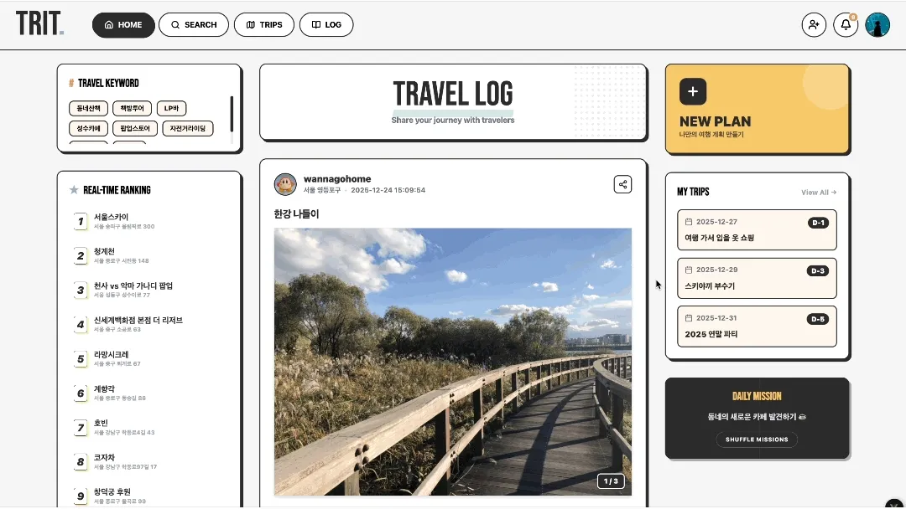
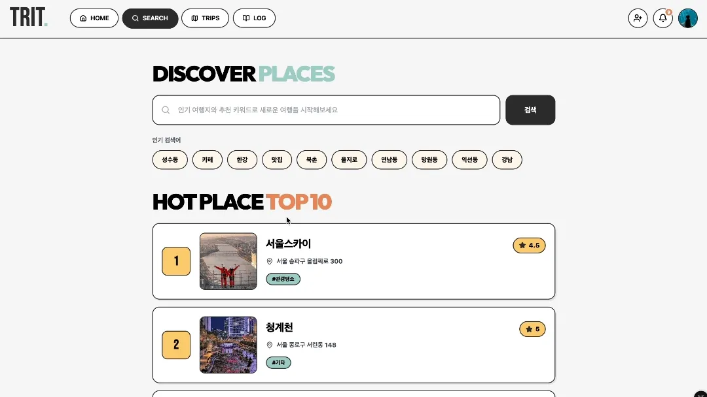
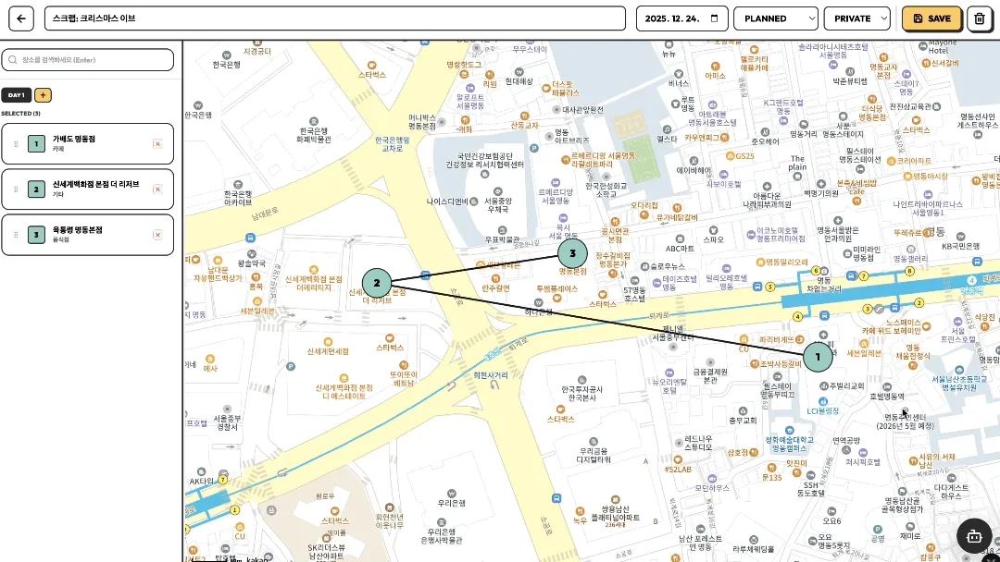
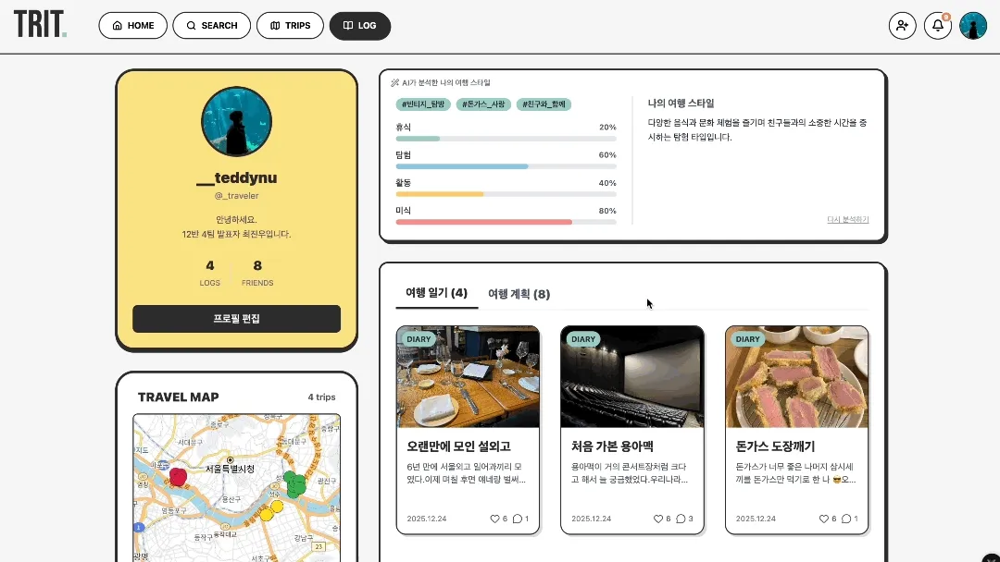
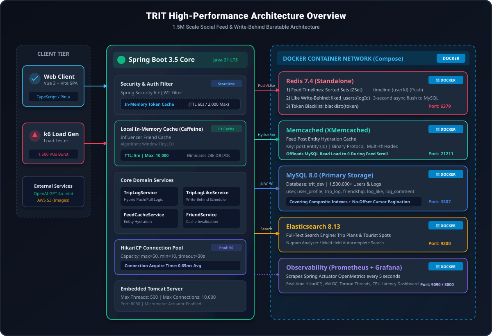
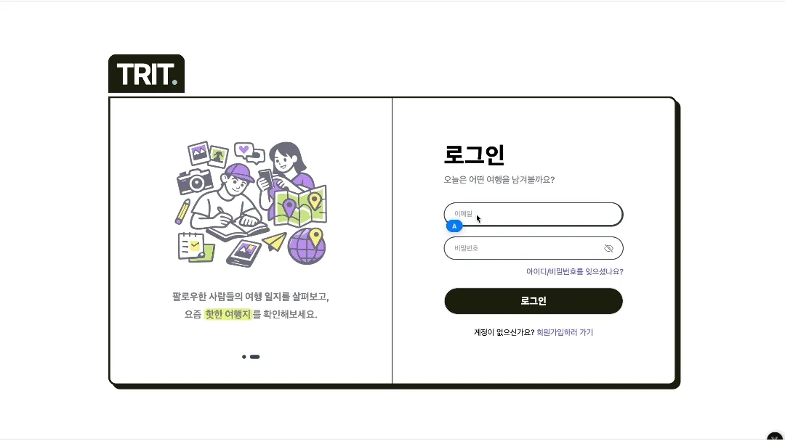
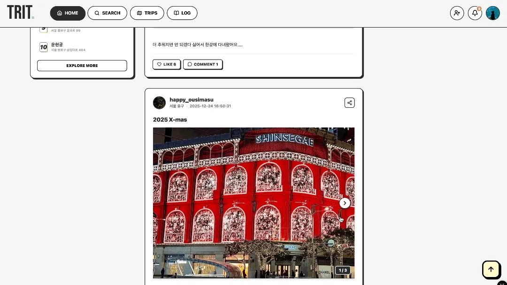
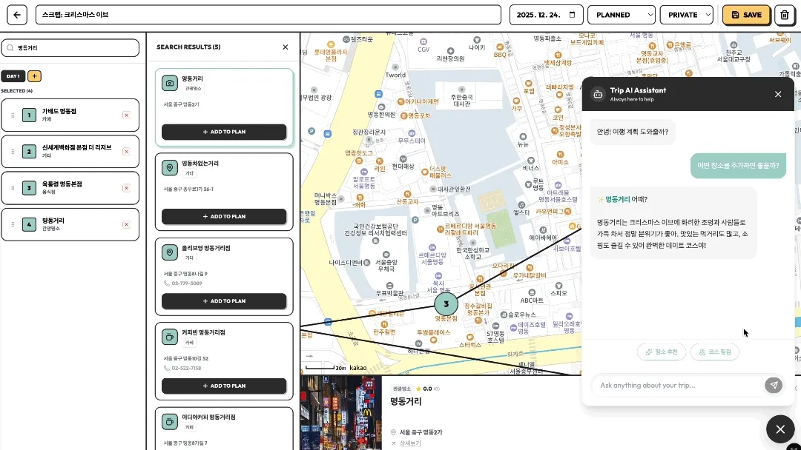
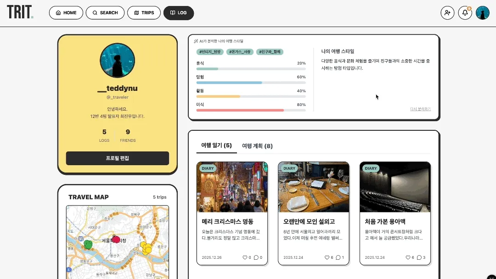
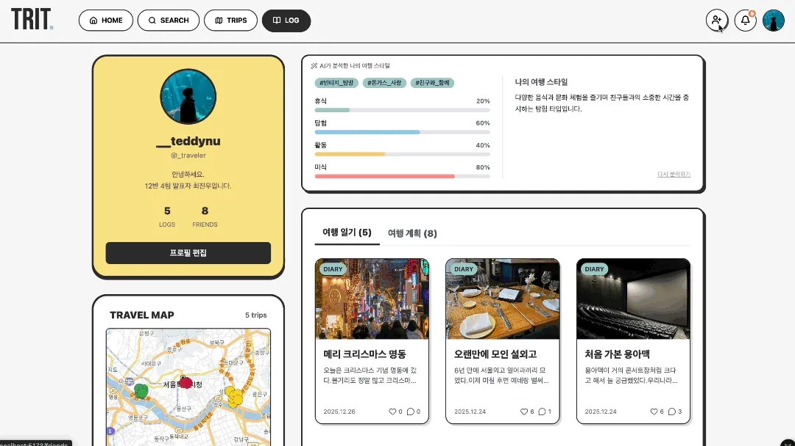

<div align="center">



<br/><br/>

<h1>TRIT</h1>

여행을 '찾고–담고–기록하는' 여행 기반 SNS

[🎥 서비스 시연 영상](https://www.youtube.com/watch?v=Y2AJf9LVbQk) &nbsp;|&nbsp; [📄 150만 가상 데이터 기반 1,500 VU 부하 테스트 리포트](./PERFORMANCE_TUNING_PORTFOLIO.md)

</div>

---

<h3>서비스 소개</h3>

TRIT(트릿)은 일상 속 짧은 외출과 여행을 기록하고, 다른 사람들의 경험을 탐색하며 새로운 장소를 발견할 수 있는 라이프로그 기반 여행 서비스입니다.

사용자는 단순한 여행 일정 계획을 넘어서 다른 사용자의 여행 루트를 참고하고, 마음에 드는 일정을 스크랩하거나, 다녀온 장소를 여행 로그로 기록하며 자신만의 취향 기반 여행 아카이브를 만들어갈 수 있습니다.

---

<h3>주요 기능</h3>

<table>
  <tr>
    <td align="center">
      <b>메인 피드</b>
    </td>
    <td align="center">
      <b>검색 페이지</b>
    </td>
  </tr>
  <tr>
    <td>
      
    </td>
    <td>
      
    </td>
  </tr>
  <tr>
    <td align="center">
      <b>AI 여행 플래너</b>
    </td>
    <td align="center">
      <b>로그 작성</b>
    </td>
  </tr>
  <tr>
    <td>
      
    </td>
    <td>
      
    </td>
  </tr>
</table>

**🔐 로그인 &amp; 사용자 관리**
* JWT 기반 인증
* 사용자 프로필 관리 (닉네임, 프로필 이미지)
* 계획페이지와 마이페이지에서 작성한 로그 / 스크랩 관리

**🔍 검색 페이지**
* 키워드 기반 검색
* 장소, 일정, 로그를 한눈에 파악 가능

**🤖 AI 여행 플래너**
* 계획 생성을 돕는 AI 여행 플래너
* 실시간 장소 추천 및 코스 점검 가능

**🧭 여행 로그 (Trip Log)**
* 방문한 장소를 하나의 여행 기록으로 저장
* 사진, 텍스트 기반 기록 지원

**👥 소셜 기능**
* 다른 사용자의 여행 기록 탐색
* 좋아요 / 친구 추가 / 알림 기능

---

<h3>서비스 아키텍처</h3>

<div align="center">
  
</div>

---

<h3>기술 스택</h3>

**Backend**

<p>
  
  
  
  
  
</p>

**Database &amp; Cache**

<p>
  
  
  
  
  
</p>

**Frontend**

<p>
  
  
  
  
  
</p>

**Infra &amp; DevOps**

<p>
  
  
  
</p>

**Testing &amp; Observability**

<p>
  
  
  
</p>

**External AI**

<p>
  
</p>

---

<h3>ERD</h3>

<details>
<summary><b>핵심 도메인</b></summary>
<br/>

</details>

<details>
<summary><b>전체 도메인</b></summary>
<br/>

</details>

---

<h3>스크린샷</h3>

<details>
<summary><b>스크린샷 펼쳐보기</b></summary>
<br/>
<table>
  <tr>
    <td align="center">
      <b>로그인</b>
    </td>
    <td align="center">
      <b>검색 페이지</b>
    </td>
  </tr>
  <tr>
    <td align="center">
      
    </td>
    <td>
      
    </td>
  </tr>
  <tr>
    <td align="center">
      <b>메인 피드</b>
    </td>
    <td align="center">
      <b>피드 상세 / 여행 스크랩</b>
    </td>
  </tr>
  <tr>
    <td>
      
    </td>
    <td>
      
    </td>
  </tr>
  <tr>
    <td align="center">
      <b>AI와 함께하는 계획 1</b>
    </td>
    <td align="center">
      <b>AI와 함께하는 계획 2</b>
    </td>
  </tr>
  <tr>
    <td>
      
    </td>
    <td>
      
    </td>
  </tr>
  <tr>
    <td align="center">
      <b>로그 작성</b>
    </td>
    <td align="center">
      <b>마이 페이지</b>
    </td>
  </tr>
  <tr>
    <td>
      
    </td>
    <td>
      
    </td>
  </tr>
  <tr>
    <td align="center">
      <b>알림 / 친구 요청</b>
    </td>
  </tr>
  <tr>
    <td>
      
    </td>
  </tr>
</table>
</details>

---

<h3>로컬 실행 가이드</h3>

* **1. 인프라 컨테이너 실행 (Docker Compose)**
```bash
cd backend
docker compose up -d
```

* **2. 백엔드 애플리케이션 실행**
```bash
cd backend
./mvnw spring-boot:run -Dspring-boot.run.profiles=dev
```

* **3. 프론트엔드 애플리케이션 실행**
```bash
cd frontend
npm install
npm run dev
```

---

<h3>팀원</h3>

<div align="center">

|  |  |  |
|:--:|:--:|:--:|
| **FE 전은진** | **FE / BE 최진우** | **FE / BE 오지현** |
| [GitHub](https://github.com/jeoneunjin) | [GitHub](https://github.com/worldclasscitizen) | [GitHub](https://github.com/zhy2on) |

</div>
